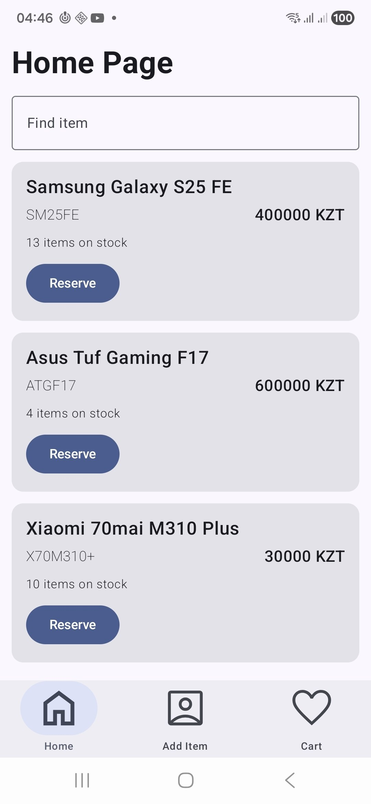
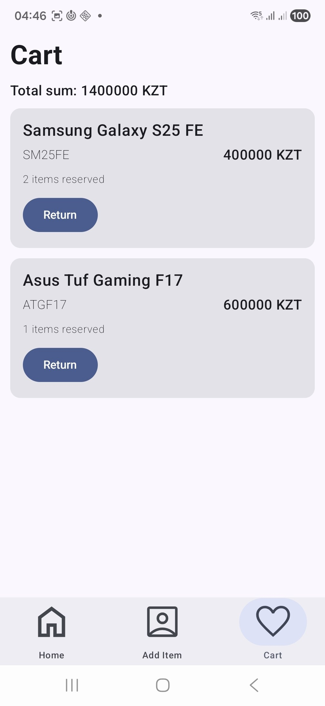
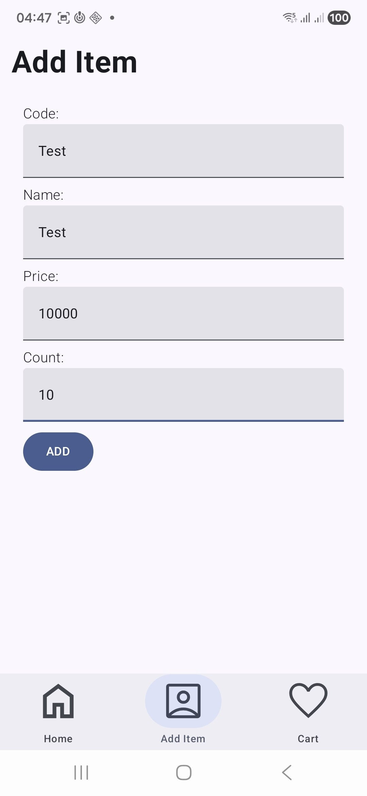
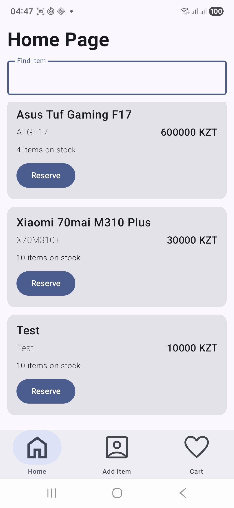

My application represents a stock of items, where user can see list of available items, reserve some item, return item from the cart, add new item.

Main page represents a list of available items in the stock:

User can search items by name:

Item can be reserved or, in other words to say, be added to the cart:

As we see, cart aggregates the cumulative price of all items.

Also, user can add a new item to the stock:

As we see, item has successfully been added:
